# Guía de uso del Sistema de Registro Territorial Comunitario

Esta guía explica, paso a paso, cómo se usa el sistema completo: el **chatbot de WhatsApp** con el que una comunidad registra su territorio, y el **visor geográfico** (página web) con el que la administradora revisa, analiza y exporta lo registrado.

> **En una frase:** el chatbot recoge, la base de datos guarda (según el modelo LADM-COL) y el visor muestra.

## Contenido

**Parte A — Para la comunidad (WhatsApp)**
1. [Panorama general](#1-panorama-general)
2. [Antes de empezar](#2-antes-de-empezar)
3. [Cómo conversa el chatbot: reglas que aplican siempre](#3-cómo-conversa-el-chatbot-reglas-que-aplican-siempre)
4. [Registrar el territorio colectivo, paso a paso](#4-registrar-el-territorio-colectivo-paso-a-paso)
5. [El perímetro: croquis o recorrido GPS](#5-el-perímetro-croquis-o-recorrido-gps)
6. [Registrar la parcela de una familia](#6-registrar-la-parcela-de-una-familia)
7. [Sin internet, errores y límites del chatbot](#7-sin-internet-errores-y-límites-del-chatbot)

**Parte B — Para la administradora (instalación y visor)**
8. [Puesta en marcha](#8-puesta-en-marcha)
9. [Entrar al visor y la barra superior](#9-entrar-al-visor-y-la-barra-superior)
10. [Dashboard](#10-dashboard)
11. [Mapas](#11-mapas)
12. [La ficha de un territorio](#12-la-ficha-de-un-territorio)
13. [Capas](#13-capas)
14. [Activos](#14-activos)
15. [Análisis espacial](#15-análisis-espacial)
16. [Informes y alertas](#16-informes-y-alertas)
17. [Configuración y roles](#17-configuración-y-roles)
18. [Funciones avanzadas: corregir linderos, plancha PDF y validación comunitaria](#18-funciones-avanzadas)
19. [Preguntas frecuentes y solución de problemas](#19-preguntas-frecuentes-y-solución-de-problemas)
20. [Dónde se guarda la información](#20-dónde-se-guarda-la-información)

---

# Parte A — Para la comunidad (WhatsApp)

## 1. Panorama general

El sistema se usa de dos maneras, que terminan en el mismo lugar:

- **La comunidad** registra su territorio o la parcela de una familia desde su celular, conversando por WhatsApp. No instala nada.
- **La administradora** (o quien tenga rol de consulta) entra al visor desde un navegador para ver el mapa, revisar fichas, analizar áreas y exportar información.

Lo que la comunidad registra por WhatsApp aparece, poco después, en el mapa del visor.

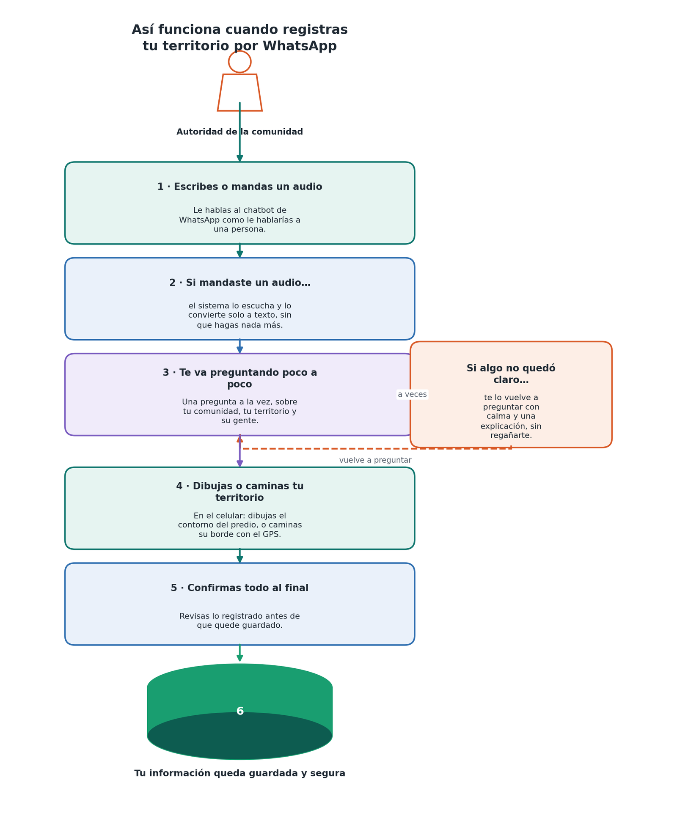

*Figura 1. Así vive la comunidad el registro: escribe o manda un audio, responde una pregunta a la vez, dibuja o camina su territorio y confirma todo al final.*

## 2. Antes de empezar

Registrar un territorio no exige nada que no se tenga ya: no hay que descargar otra aplicación, crear cuentas ni pagar.

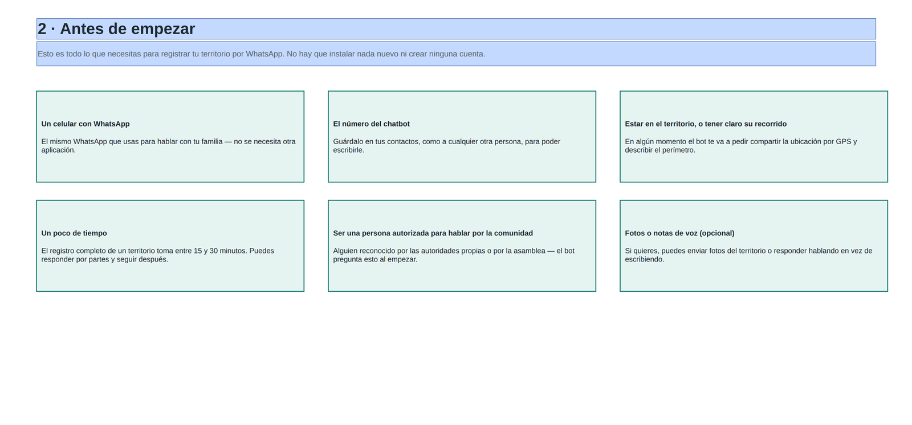

*Figura 2. Lo que conviene tener a mano.*

| Qué necesitas | Detalle |
|---|---|
| Un celular con WhatsApp | El mismo que ya usas. |
| El número del chatbot | Guárdalo en tus contactos como cualquier otro. |
| Estar en el territorio (o tener claro su recorrido) | En algún momento el bot pide la ubicación por GPS y la descripción del perímetro. |
| Tiempo | El registro completo de un territorio toma entre 15 y 30 minutos; se puede responder por partes y seguir después. |
| Ser una persona autorizada | Quien conversa con el bot debe ser reconocida por las autoridades propias o la asamblea para hablar en nombre de la comunidad. El bot lo pregunta al comienzo, como parte del consentimiento informado. |
| Fotos o notas de voz (opcional) | Se pueden enviar fotos o responder hablando en vez de escribir. |

## 3. Cómo conversa el chatbot: reglas que aplican siempre

Todo empieza escribiendo al chatbot como a cualquier contacto: **«hola»**, **«inicio»**, **«start»** o **«registrar»** bastan para arrancar. Desde ahí el bot guía la conversación, **una pregunta a la vez**.

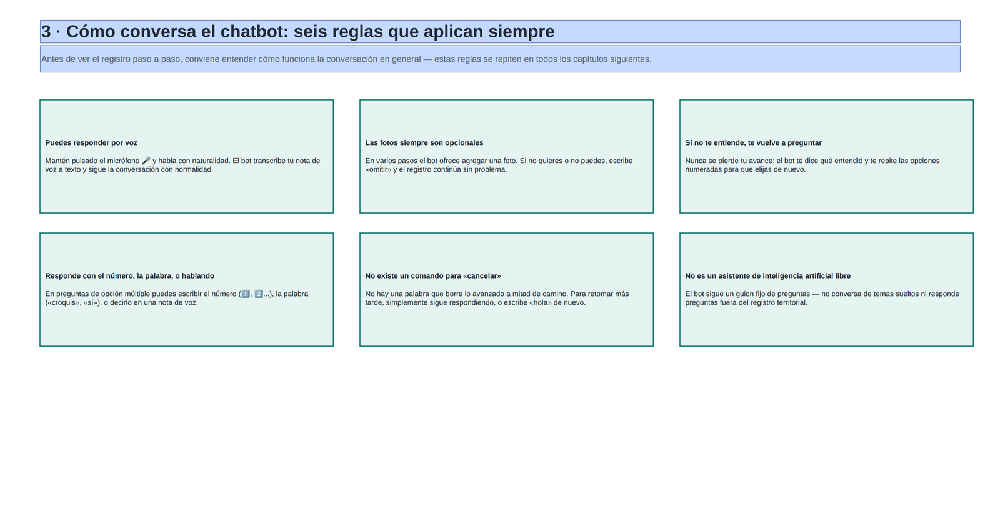

*Figura 3. Las seis reglas que valen durante todo el registro.*

### 3.1 Responder escribiendo o hablando
En cualquier pregunta puedes mandar una **nota de voz** (mantén pulsado el micrófono 🎤). El bot la transcribe y sigue como si la hubieras escrito. La nota de voz se borra después de transcribirse: solo se guarda el texto. Hay dos excepciones, donde el audio **sí se conserva** además de la transcripción: al contar la historia del territorio y en las observaciones finales de la validación.

### 3.2 Las fotos son siempre opcionales
En ocho momentos del registro colectivo y uno del familiar el bot ofrece agregar una foto (del territorio, de un lindero, de un documento…). Nunca es obligatorio: escribe **«omitir»** y sigue.

### 3.3 Preguntas de opción múltiple
Puedes responder de tres formas:

1. Tocando el **botón**, si aparece en tu WhatsApp.
2. Escribiendo el **número** de la opción (1️⃣, 2️⃣…).
3. Escribiendo o diciendo una **palabra clave** (por ejemplo «resguardo» o «cabildo»).

Si tu respuesta coincide con más de una opción, el bot pregunta cuál quisiste decir antes de continuar.

### 3.4 Si el bot no te entiende
No pierdes lo ya avanzado: el bot dice qué entendió y vuelve a mostrar las opciones. Si una nota de voz no se transcribe con claridad, pide que la repitas.

### 3.5 Qué no existe
No hay palabra para «cancelar» a mitad de camino (se retoma respondiendo, o escribiendo «hola» más adelante). Tampoco es un asistente de conversación libre: sigue siempre el mismo guion del registro territorial.

## 4. Registrar el territorio colectivo, paso a paso

El recorrido completo se agrupa en 8 grandes momentos:

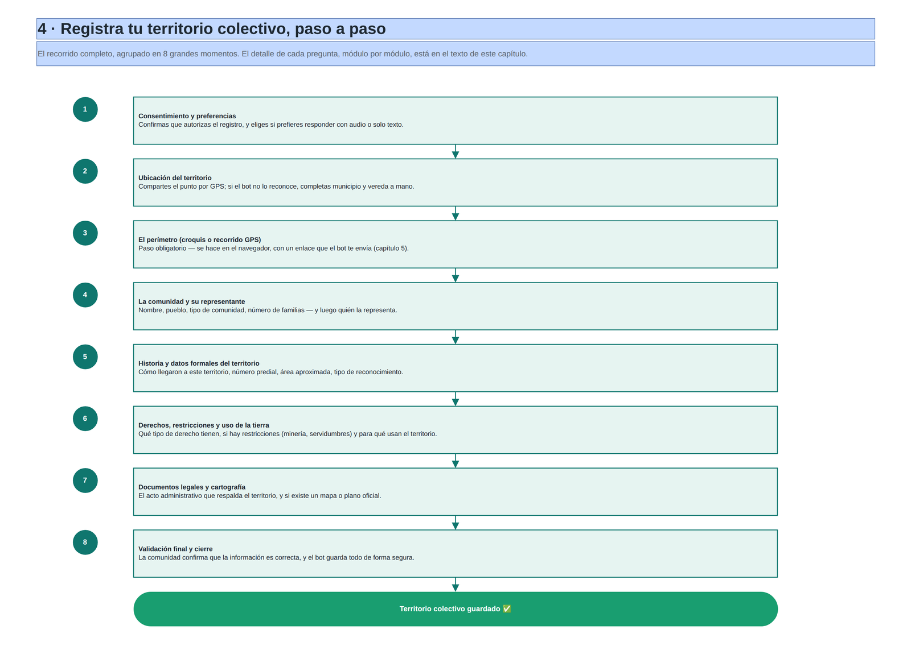

*Figura 4. Registro de un territorio colectivo.*

Visto como una línea de nueve módulos (del 0 al 9):

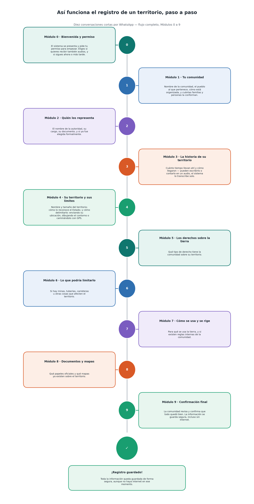

*Figura 5. Los módulos del chatbot, de la bienvenida a la confirmación final.*

### Paso 1 · Consentimiento y preferencias
Al escribir «hola», el bot se presenta y pregunta si **autorizas** recopilar la información de forma voluntaria para el reconocimiento territorial. Si dices que no, la conversación termina ahí y puedes retomarla cuando quieras. Si aceptas, pregunta:

- si prefieres completar el registro **en línea** (por WhatsApp) o con un **formulario web sin conexión**, y
- si quieres que cada pregunta llegue **también en audio** o solo en texto.

### Paso 2 · Qué se va a registrar
El bot pregunta si registrarás el **territorio colectivo completo** o la **parcela de una sola familia**. Este capítulo cubre la primera opción; la segunda está en el [capítulo 6](#6-registrar-la-parcela-de-una-familia).

### Paso 3 · Ubicación
El bot pide compartir la ubicación con la función nativa de WhatsApp (clip 📎 o botón «+» → *Ubicación* → *Enviar mi ubicación actual*). Con esas coordenadas, el sistema identifica solo el departamento, el municipio y, si puede, la vereda. Si no reconoce el lugar, pregunta el municipio y la vereda. Si no puedes compartir la ubicación, responde **«no»** y completa los tres datos a mano.

### Paso 4 · El perímetro
Es un paso **obligatorio**, con su propio mecanismo (un enlace que se abre en el navegador). Se explica en el [capítulo 5](#5-el-perímetro-croquis-o-recorrido-gps).

### Paso 5 · Módulo 1 — Identificación de la comunidad
Ocho preguntas seguidas:

1. Nombre con el que se identifica la comunidad.
2. Tipo de comunidad: consejo comunitario / comunidad negra, cabildo indígena, parcialidad, resguardo indígena o territorio colectivo.
3. Pueblo indígena o grupo étnico al que pertenece.
4. Cómo se organizan: cabildo, autoridades tradicionales, asamblea comunitaria, consejo comunitario u otro.
5. Cuántas **familias** viven en el territorio.
6. Cuántas **personas** en total.
7. Cuántas son **mujeres**.
8. Cuántas son **hombres**.

Los números se pueden escribir en dígitos o decir en voz alta («cuarenta y cinco»): el bot los reconoce igual.

### Paso 6 · Módulo 2 — Representante legal o autoridad
Seis preguntas sobre quien representa a la comunidad: nombre completo; cargo (gobernador/a, capitán, cacique, autoridad tradicional, representante legal del consejo comunitario u otro); tipo de documento; número de documento (o «no aplica»); si fue elegida o reconocida formalmente o el proceso sigue en curso; y, opcional, un teléfono de contacto.

### Paso 7 · Módulo 3 — Historia del territorio
Primero, desde cuándo habita la comunidad el territorio (desde siempre, desde hace muchos años, fecha aproximada o no se conoce). Luego se pide contar cómo llegaron, con texto largo o nota de voz (si respondes hablando, **el audio se conserva** además de la transcripción). Por último, una foto opcional del territorio.

### Paso 8 · Módulo 4 — Datos formales del territorio
- Nombre oficial del territorio (puede ser el mismo ya dicho).
- Número predial o cédula catastral, si se conoce.
- Área aproximada en hectáreas («desconocida» si no se sabe).
- Tipo de procedimiento de reconocimiento: ampliación de resguardo, ampliación y saneamiento, reestructuración, conversión de reserva, titulación de comunidades negras, o en proceso / no reconocido.
- Cómo describe la comunidad los límites: ríos y quebradas, montañas y cerros, caminos y senderos, hitos naturales, documentos oficiales o una combinación.
- Foto opcional de un lindero y foto opcional de zonas especiales o sitios sagrados.

### Paso 9 · Módulo 5 — Derecho y restricciones
Qué derecho tiene la comunidad (propiedad colectiva reconocida, posesión ancestral, uso y usufructo, en proceso de legalización o desconocido) y si existen restricciones o servidumbres (minería, oleoducto, gasoducto, energía eléctrica, acueducto, alcantarillado, tránsito, restricción legal por hidrocarburos o ninguna), con foto opcional de evidencia.

### Paso 10 · Módulo 6 — Uso del territorio
Uso principal (colectivo comunitario, tradicional o cultural, zonas compartidas con otras comunidades o mixto) y si existen reglas internas propias sobre su uso.

### Paso 11 · Módulo 7 — Documentos legales
Si existe un documento oficial que reconozca el territorio (resolución, acuerdo, decreto, sentencia, folio de matrícula inmobiliaria o ninguno). Si existe, pide el número del acto y su fecha en formato **día/mes/año** (por ejemplo `15/03/2005`, o «desconocida»), y si el predio figura con otro nombre. En ambos casos ofrece una foto opcional del documento o de cualquier evidencia informal (acta de asamblea, solicitud radicada).

### Paso 12 · Módulo 8 — Cartografía
Si la comunidad tiene algún mapa o plano (oficial del IGAC u otra entidad, mapa comunitario propio, o ninguno), una foto opcional y el número de referencia cartográfica si se conoce.

### Paso 13 · Módulo 9 — Validación comunitaria y cierre
Si la información fue revisada y aprobada por la comunidad (validada en asamblea, revisada por las autoridades o pendiente), foto opcional de esa reunión, observaciones finales y, si se desea, un mensaje de voz con palabras finales (el bot lo transcribe y lo confirma antes de guardar).

Al terminar, el bot guarda todo y responde con una confirmación con el **número de registro**, el nombre de la comunidad, el departamento y el municipio. Si en ese momento no hay conexión con el servidor, el registro queda guardado con un identificador temporal y se sincroniza solo al volver la señal (ver [capítulo 7](#7-sin-internet-errores-y-límites-del-chatbot)).

### Lógica de cada pregunta
Detrás de cada pregunta ocurre siempre lo mismo: el bot revisa si la respuesta tiene el formato esperado; si no, repite la pregunta con una explicación; si sí, la guarda y pasa a la siguiente.

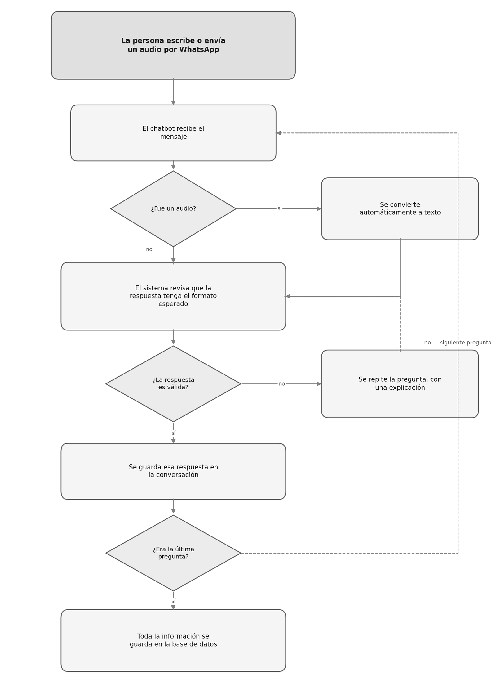

*Figura 6. Qué hace el sistema con cada respuesta (texto o audio).*

### Cómo valida el bot cada dato

| Dato | Validación |
|---|---|
| Números (familias, personas, hectáreas…) | Solo enteros desde cero; por voz reconoce «cuarenta y cinco» → 45. |
| Fecha del acto administrativo | Día/mes/año (`15/03/2005`); también acepta «desconocida» o «no sé». |
| Documento de identidad | No valida un formato de cédula; acepta cualquier texto de más de un par de caracteres. |
| Teléfono de contacto | Opcional; si se deja, mínimo 7 dígitos. |
| Ubicación | Debe llegar como ubicación nativa de WhatsApp para geocodificarse sola; si no, se completa a mano. |
| Perímetro | **Obligatorio**: el registro no avanza hasta guardar el croquis o el recorrido. |

## 5. El perímetro: croquis o recorrido GPS

Este paso es **idéntico** para el territorio colectivo y para la parcela de una familia, y **no se puede omitir**. El bot ofrece dos formas de definir el contorno y envía un **enlace único** que se abre en el navegador del celular (no ocurre dentro de WhatsApp, aunque el enlace lo manda el chatbot).

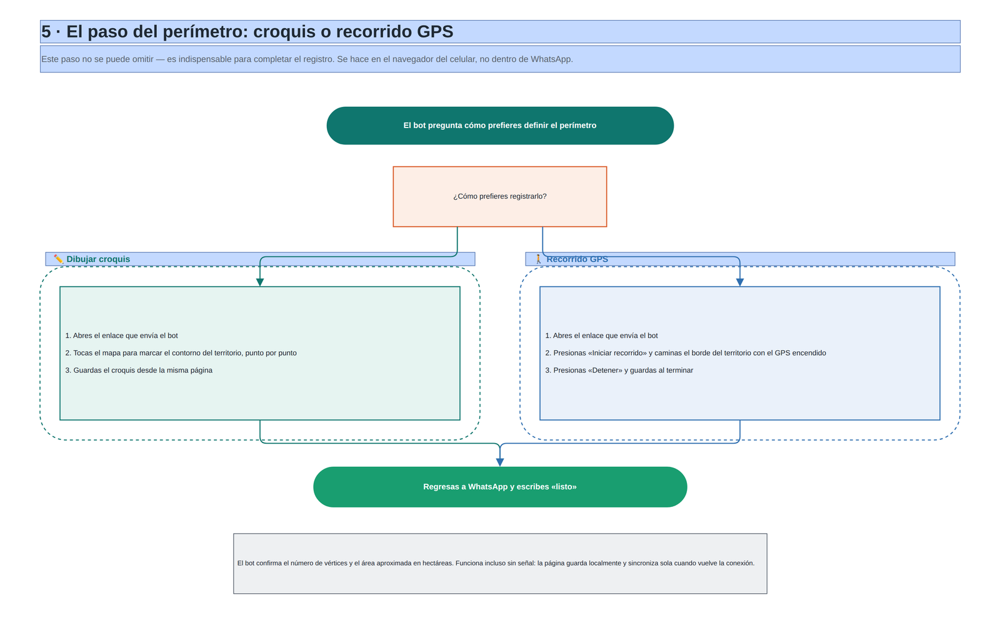

*Figura 7. Croquis o recorrido GPS, y cómo confirmarlo de vuelta en WhatsApp.*

### ✏️ Opción 1 — Dibujar un croquis
1. Abre el enlace que te envía el bot.
2. Ubícate en el mapa y toca cada esquina del terreno, punto por punto.
3. Cierra la figura.
4. Pulsa **«Guardar y enviar»**. La página muestra el área aproximada mientras dibujas; el botón de borrar deshace el dibujo.

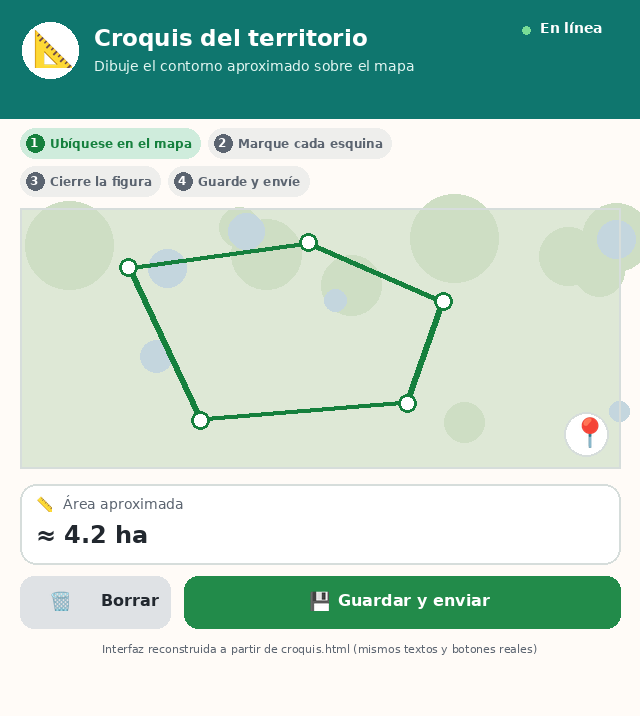

*Figura 8. Pantalla del croquis (interfaz reconstruida a partir de `croquis.html`).*

### 🚶 Opción 2 — Recorrido GPS
1. Abre el enlace y presiona **«Iniciar recorrido»**.
2. Camina **todo el borde** del territorio con el GPS del celular encendido, sin atajos.
3. Al cerrar la vuelta, presiona **«Finalizar y guardar»**. Mientras caminas se ven los puntos GPS, la distancia y el tiempo.

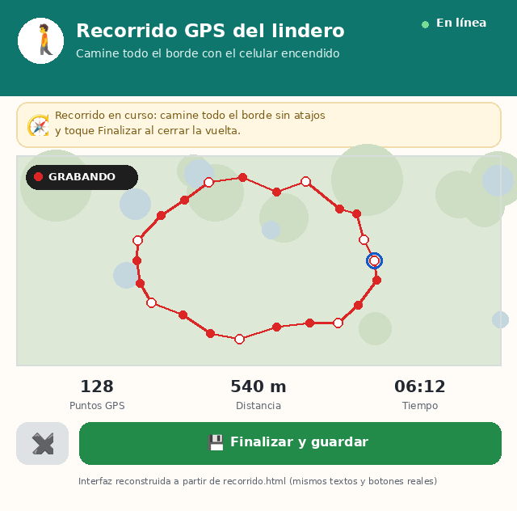

*Figura 9. Pantalla del recorrido GPS (interfaz reconstruida a partir de `recorrido.html`).*

### Volver a WhatsApp
En los dos casos, regresa al chat y escribe **«listo»**. El bot revisa si ya recibió los datos: si todavía no, te pide un momento y que lo intentes de nuevo; en cuanto los detecta, confirma el **número de vértices** y el **área aproximada en hectáreas**, y continúa con el registro.

> **Funciona sin señal:** estas páginas guardan el croquis o el recorrido en el propio celular y los sincronizan cuando vuelve la conexión. No hay que repetir el dibujo si se corta internet.

## 6. Registrar la parcela de una familia

Un camino más corto, para cuando el territorio colectivo **ya está registrado** y falta agregar los datos de una familia dentro de él. No vuelve a preguntar datos de la comunidad, del representante ni la historia.

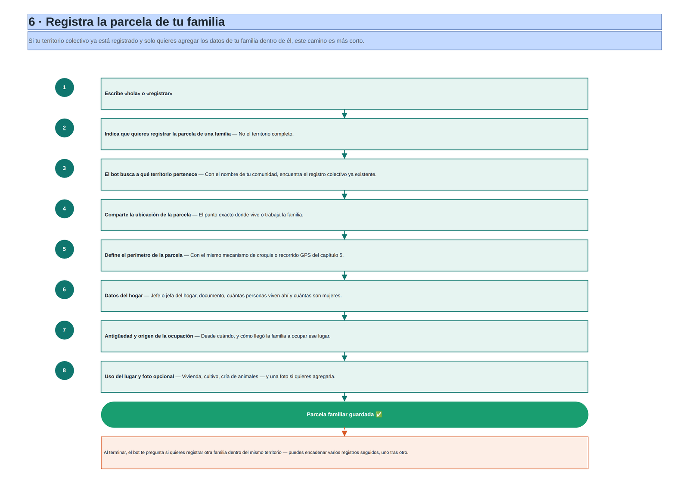

*Figura 10. Registro de la parcela de una familia, dentro de un territorio existente.*

1. **Escribe «hola»** o «registrar» y elige **parcela de una familia**.
2. **El bot encuentra el territorio por ti.** Pregunta el nombre de la comunidad o resguardo y busca coincidencias: si hay una sola, la asume y te avisa; si hay varias, muestra una lista numerada; si no hay ninguna, sugiere escribir **«territorio»** para registrar primero el territorio completo.
3. **Ubicación y perímetro de la parcela**, con el mismo mecanismo del [capítulo 5](#5-el-perímetro-croquis-o-recorrido-gps).
4. **Datos del hogar:** nombre completo de quien es jefe o jefa de hogar (la familia queda como «Familia [Apellido]»), tipo y número de documento, cuántas personas viven en la casa (entre 1 y 60) y cuántas son mujeres. El bot calcula los hombres restando y te confirma el resultado para que lo corrijas si hace falta.
5. **Antigüedad y origen de la ocupación:** desde cuándo vive la familia allí, y cómo llegó (asignada por la asamblea o el cabildo, herencia familiar, ocupación antigua —ya estaban antes del título colectivo—, cambio o cesión con otra familia, o no se sabe).
6. **Uso del lugar y cierre:** vivienda y cultivo, solo vivienda, cultivo o pancoger, cría de animales, o bosque y conservación; foto opcional de la casa. Al guardar, el bot muestra un resumen con cuántas familias y personas van registradas **contra lo que la autoridad estimó** en el módulo 1, y pregunta si quieres registrar **otra familia** del mismo territorio (puedes encadenar varias sin volver a escribir «hola»).

> **Importante — qué derecho queda registrado.** El origen de la ocupación determina el derecho: si fue *ocupación antigua* se guarda como **posesión ancestral**; en cualquier otro caso, como **uso y usufructo**. Nunca se registra como propiedad individual: el título colectivo del territorio es inalienable y la parcela familiar es un derecho de uso *dentro* de él.

## 7. Sin internet, errores y límites del chatbot

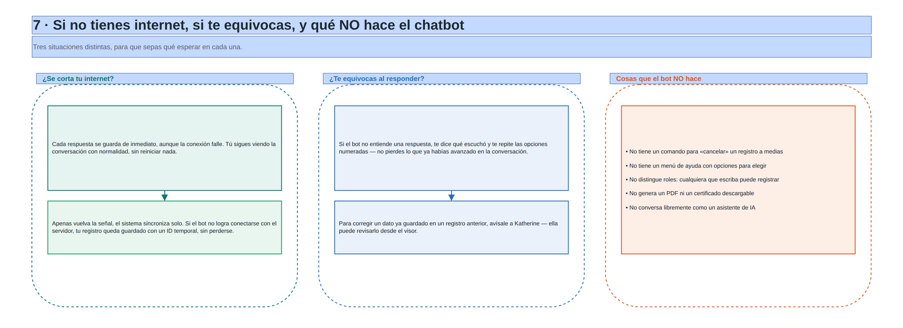

*Figura 11. Tres situaciones que conviene distinguir.*

### Si se corta tu internet a mitad de la conversación
Cada respuesta queda guardada de inmediato y el sistema sincroniza solo al volver la señal; no hay que reiniciar desde cero. Si al **finalizar** no hay conexión con el servidor principal, el bot guarda el registro en una cola local con un número temporal y lo sincroniza automáticamente cuando se restablece.

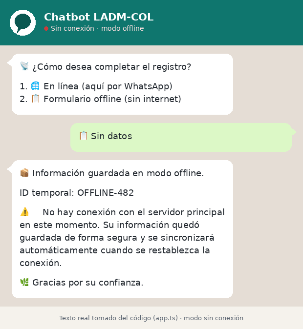

*Figura 12. Mensaje que recibe la comunidad cuando se guarda sin conexión (texto tomado del código).*

Además existe el **formulario web sin conexión** (`offline-form.html`), que se elige al inicio de la conversación y funciona sin señal; sincroniza cuando vuelve la conexión.

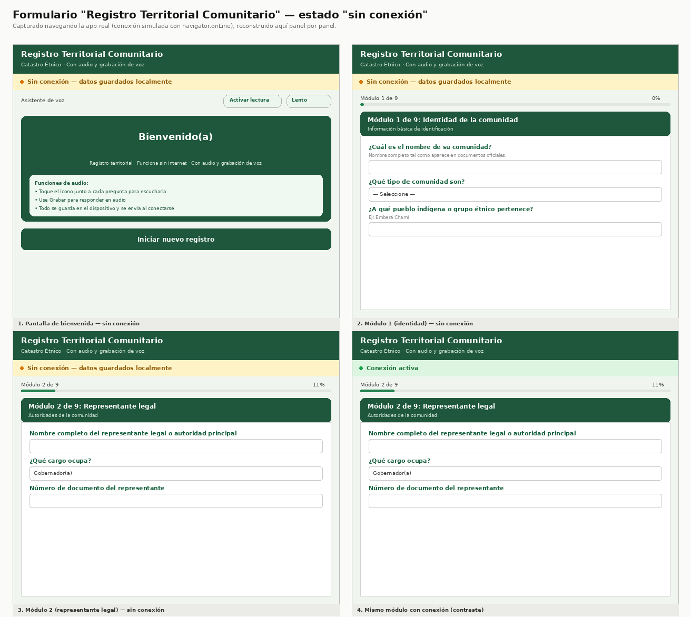

*Figura 13. El formulario «Registro Territorial Comunitario» en estado «sin conexión»: los datos se guardan localmente.*

### Si te equivocas o el bot no te entiende
El bot nunca avanza con una respuesta que no interpretó: dice qué entendió y repite las opciones, sin perder lo ya respondido. Para corregir un dato **ya guardado**, la comunidad debe avisar a la administradora; el bot no permite editar un registro cerrado (la administradora puede corregir el lindero desde el visor; ver [capítulo 18](#18-funciones-avanzadas)).

### Lo que el chatbot NO hace

| No existe… | Qué hacer en su lugar |
|---|---|
| Comando de «ayuda» o menú | Solo «hola», «inicio», «start» o «registrar» arrancan la conversación. |
| Comando para «cancelar» | Seguir respondiendo cuando se pueda, o escribir «hola» más adelante. |
| Distinción de roles de quien escribe | Cualquier número puede iniciar un registro; la comunidad declara quién lo hace en la validación final. |
| PDF o certificado descargable desde el chat | El comprobante es el mensaje con el número de registro. Los PDF (plancha) los genera la administradora desde el visor. |
| Asistente de IA de conversación libre | El reconocimiento de voz solo transcribe audio a texto; las respuestas se interpretan con reglas fijas. |
| Consulta del estado de una solicitud por WhatsApp | Se hace desde el visor. |

---

# Parte B — Para la administradora

## 8. Puesta en marcha

> Esta sección resume lo esencial. El detalle (con comandos y tabla de fallos) está en [`COMO_EJECUTAR.md`](../COMO_EJECUTAR.md) y la forma de exponer el visor en internet, en [`PUBLICAR.md`](../PUBLICAR.md).

### 8.1 Requisitos
- Node.js y npm.
- PostgreSQL con la extensión **PostGIS**.
- Cuenta de WhatsApp Business API (Meta), clave de Groq (transcripción de voz), clave de Azure Speech (generar los audios de las preguntas) y token de Mapbox (mapa base; sin él se usa OpenStreetMap).

### 8.2 Una sola vez

1. **Variables de entorno.** Copia `.env.example` a `.env` y completa tus valores. **Nunca subas `.env` a GitHub.**
2. **Instalar dependencias:** `npm install`.
3. **Crear la base** `catastro_etnico` y aplicar `schema.sql` y `setup_db.sql`.
4. **Aplicar las migraciones, en este orden:**

   | Archivo | Para qué |
   |---|---|
   | `migrate_postgis.sql` | Activa PostGIS, la columna de coordenadas y el usuario del visor |
   | `migrate_perimetro.sql` | Polígonos del territorio (croquis y recorrido GPS) |
   | `migrate_voz_fotos.sql` | Transcripciones de respuestas habladas y fotos |
   | `migrate_ladm.sql` | Alineación con LADM-COL: catálogos, topología del lindero y clases faltantes |
   | `migrate_familias.sql` | Levantamiento por familias y censo declarado vs. medido |
   | `migrate_edicion_poligono.sql` | Bitácora y funciones para corregir y unir polígonos |
   | `migrate_validacion_comunitaria.sql` | Envío del resultado a la comunidad para validarlo |
   | `migrate_recordatorio_perimetro.sql` | Recordatorio de perímetro pendiente |

   Son idempotentes: correrlas dos veces no daña nada. Al arrancar, el visor dice `✅ Migraciones al día` o indica cuál falta.
5. **Cambiar la contraseña del administrador:** `node scripts/cambiar-password.mjs`. La migración crea `admin` con la contraseña de ejemplo `admin123`; **cámbiala antes de publicar el visor**.
6. **Definir `GEOVISOR_JWT_SECRET`** en el `.env` con una cadena larga y aleatoria (el visor no arranca sin ella).
7. **Generar los audios de las preguntas** (47 archivos en `Preguntas/`): `node generar_audios_azure.mjs`. Solo se repite si cambias el texto de una pregunta.

### 8.3 Cada vez que trabajes (dos terminales)

| Terminal | Comando | Qué hace |
|---|---|---|
| 1 | `npm run start:all` | Levanta el túnel y el chatbot. Copia la URL pública que muestra. |
| 2 | `npm run geovisor` | Visor solo en tu computador: <http://localhost:3009> |
| 2 (alt.) | `npm run geovisor:publico` | Visor con dirección pública (ngrok), para abrirlo desde otro equipo o el celular |
| — | `npm run dev:all` | Chatbot y visor a la vez |

El chatbot está listo cuando ves `✅ PostgreSQL conectado correctamente` y `✅ Connected Provider`. El visor, cuando ves `✅ PostgreSQL conectado`, `✅ Migraciones al día` y `📡 PostgreSQL LISTEN activo`.

### 8.4 Webhook de Meta
Solo si la URL del túnel cambió (túnel temporal): en **Meta for Developers → tu App → WhatsApp → Configuración → Webhook** pega la URL + `/webhook`, usa tu `META_VERIFY_TOKEN` y verifica que el campo **`messages`** esté activado.

### 8.5 Probar que todo funciona
1. Escribe **hola** al número del bot.
2. Avanza el registro, comparte ubicación, responde algo con nota de voz (debe contestar `🎙️ Audio transcrito:`).
3. Abre el enlace del croquis, dibuja y guarda.
4. Termina el registro.
5. En el visor debe saltar el aviso 🔔 con el registro nuevo y aparecer el territorio en el mapa.

## 9. Entrar al visor y la barra superior

Abre la dirección del visor en el navegador (Chrome, Firefox, etc.) e inicia sesión con tu usuario y contraseña. La sesión **dura 8 horas**; luego vuelve a pedirla (no se pierde nada: los datos están en la base).

La barra superior siempre visible contiene, de izquierda a derecha: el nombre del sistema, el **selector de región**, las **siete pestañas**, el indicador **«En vivo»**, la **campana** de alertas y tu **cuenta**.

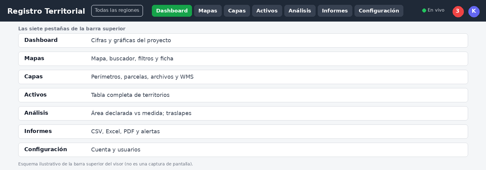

*Figura 14. Esquema de la barra superior y de sus siete pestañas.*

| Pestaña | Para qué sirve |
|---|---|
| **Dashboard** | Cifras y gráficas del proyecto; últimos territorios registrados. |
| **Mapas** | El mapa con buscador, filtros y ficha de cada registro. |
| **Capas** | Perímetros, parcelas familiares, archivos propios y servicios WMS. |
| **Activos** | Tabla completa de territorios, con buscador propio. |
| **Análisis** | Área declarada vs. medida y revisión de traslapes. |
| **Informes** | Exportar a CSV, Excel o PDF, y revisar alertas de calidad. |
| **Configuración** | Tu cuenta, contraseña y (si eres administradora) los usuarios. |

- **Selector de región.** «Todas las regiones» filtra el visor completo por departamento (panel, mapa, Activos, Análisis y exportaciones).
- **«En vivo».** El punto verde indica que el visor está conectado a la base y se entera al instante de un registro nuevo: aparece un aviso («📨 Nuevo registro: …») y los datos se actualizan solos. Si dice «Sin conexión», el visor reintenta automáticamente.
- **Campana 🔔.** Muestra en rojo cuántas alertas hay. Al abrirla, cada alerta lleva a la ficha del registro afectado.
- **Tu cuenta.** El círculo con tu inicial abre un menú con tu nombre y rol, acceso a Configuración, enviar mensaje al chatbot (solo administradora) y cerrar sesión.

## 10. Dashboard

Es la pestaña que se abre al entrar. Arriba, cuatro tarjetas; debajo, tres gráficas; al final, los últimos cinco territorios registrados.

| Tarjeta | Qué cuenta |
|---|---|
| **Comunidades** | Cuántas han completado un registro (y cuántas en los últimos 7 días). |
| **Personas** | Suma de personas reportadas (y total de familias). |
| **Territorio medido** | Hectáreas que suman los perímetros efectivamente capturados en campo (no el área de los documentos legales). |
| **Con polígono** | Cuántas comunidades ya tienen perímetro capturado, de las que compartieron ubicación: mide el avance del levantamiento. |

Las gráficas muestran comunidades por departamento, por tipo de comunidad y registros por mes. Si no hay datos suficientes aparece «Sin datos todavía». En la tabla, una etiqueta indica cómo se capturó el perímetro: **Croquis**, **Recorrido GPS** o **Sin capturar**. El botón «Ver todos» lleva a Activos.

> Si «Territorio medido» y «Con polígono» están en cero y sale un aviso amarillo, no faltan datos: falta aplicar una **migración**. El aviso trae el comando exacto.

## 11. Mapas

Una columna de herramientas a la izquierda y el mapa ocupando el resto.

- **Buscar y filtrar.** El buscador encuentra por nombre de comunidad, pueblo étnico o municipio mientras escribes. Los filtros: tipo de comunidad, departamento, tipo de derecho y rango de fechas. **Aplicar** los activa; **Limpiar** los quita todos.
- **Tres formas de ver el mapa:**
  - **Puntos:** una marca por comunidad, con color según el tipo.
  - **Cluster:** agrupa marcas cercanas en círculos numerados que se separan al acercar.
  - **Calor:** manchas de color según dónde se concentra la población (pesa cuánta gente hay, no solo cuántas comunidades).
- **Mapa de fondo.** Control de capas (arriba a la derecha): calles (OpenStreetMap), satélite o topográfico (útil para ver ríos y relieve al revisar un lindero).
- **Lista y línea de tiempo.** Debajo de los filtros está la lista de registros; al hacer clic se abre su ficha. El botón **Timeline** abre una barra deslizante que muestra cómo fueron apareciendo los registros en el tiempo.

> En el mapa solo aparecen las comunidades que **compartieron su ubicación**. Una comunidad sin ubicación existe en la base y se ve en Activos, pero no tiene dónde dibujarse; por eso la tarjeta «Comunidades» puede superar la cantidad de puntos visibles.

## 12. La ficha de un territorio

Es la pantalla más importante: reúne todo lo que una comunidad respondió. Se abre desde un punto del mapa, la lista lateral, una fila de Activos o Análisis, o una alerta. Aparece como un panel que se desliza desde la derecha y se cierra con la equis o con **Escape**.

Muestra, según haya información:

1. Datos de la comunidad.
2. Representante legal o autoridad.
3. Territorio: **área declarada** (la del documento legal), **área real medida** (la que encierra el polígono capturado), **perímetro** en kilómetros y **método de captura** (croquis o recorrido GPS).
4. Derechos y restricciones.
5. Historia y uso (con transcripciones de notas de voz).
6. Validación comunitaria.
7. **Censo:** personas y familias estimadas por la autoridad frente a las levantadas casa por casa, con barra de avance.
8. Parcelas familiares registradas dentro del territorio.
9. Documentos que sustentan el derecho.
10. Lindero tramo por tramo.
11. Fotografías (se abren en grande) y respuestas habladas transcritas.

Botones al final: **Ver en el mapa** (lleva el mapa hasta ese territorio), y, solo para administradoras, **enviar mensaje al chatbot**, **eliminar el registro** y las acciones de [funciones avanzadas](#18-funciones-avanzadas).

> **Borrar es definitivo.** Al borrar una comunidad se eliminan también su representante, historia, derechos, documentos, fotos, transcripciones y las parcelas familiares. El visor pide confirmación. Borrar una familia solo elimina su parcela.

## 13. Capas

Aquí se activa lo que se dibuja sobre el mapa. Los cambios se ven en la pestaña **Mapas**.

- **Perímetros de los territorios.** Dibuja en verde el perímetro de todas las comunidades que ya lo tienen capturado, e indica cuántos territorios y cuántas hectáreas suman. Permite notar si dos territorios se tocan o si uno quedó mal trazado.
- **Parcelas familiares.** En naranja punteado, en una capa aparte a propósito: el territorio es colectivo y la familia solo tiene derecho de uso sobre su parte.
- **Subir un archivo propio** (se dibuja en morado y muestra sus datos al hacer clic):

  | Formato | Qué subir |
  |---|---|
  | GeoJSON | El `.geojson` o `.json` directamente. |
  | Shapefile | Un `.zip` que contenga juntos `.shp`, `.dbf` y `.shx` (idealmente `.prj`). Sueltos no cargan. |
  | KML | El `.kml` tal como lo exporta Google Earth. |
  | KMZ | El `.kmz`; el visor lo descomprime solo. |

  Solo hay una capa externa a la vez, y es **temporal**: vive en tu navegador y no se guarda en la base.
- **Servicio WMS.** Pega la dirección del servicio (por ejemplo, del IGAC) y usa **«Ver capas disponibles»** si el servicio lo permite; si no, escribe el nombre exacto de la capa. Cada capa agregada tiene su ✕ para quitarla. Si no aparece: revisa que la dirección y el nombre estén exactos, o que el servicio permita consultas desde un navegador.

## 14. Activos

La tabla completa de territorios, sin mapa de por medio. El buscador filtra por comunidad, pueblo o municipio mientras escribes; muestra **veinte registros por página**; al hacer clic en una fila se abre la ficha. Los dos botones a la derecha del buscador exportan **lo que estás viendo** (con buscador y región aplicados) a CSV o Excel.

## 15. Análisis espacial

Responde dos preguntas que no se contestan mirando un registro a la vez:

1. **¿Coincide el área del documento con la medida en campo?** La gráfica pone, para cada comunidad, dos barras: azul = hectáreas del acto administrativo; naranja = hectáreas que encierra el perímetro capturado. La tabla agrega la columna **Diferencia** en porcentaje (verde: pequeña, naranja: apreciable, roja: muy grande). Las áreas se calculan sobre la forma real de la Tierra, no sobre coordenadas planas.
2. **¿Hay territorios que se están pisando?** El visor compara todos los perímetros y avisa si dos se superponen, con las hectáreas compartidas y el porcentaje para cada uno. Si solo se tocan por el borde, **no** cuenta como traslape.

Al final, una tabla resume comunidades y personas por municipio, para ver dónde está concentrado el trabajo.

> Una diferencia grande de área no significa necesariamente un error: la comunidad pudo dibujar solo una parte, el documento puede incluir predios en disputa o estar desactualizado. Indica dónde mirar con calma.

## 16. Informes y alertas

### Exportar
| Formato | Contenido |
|---|---|
| **CSV** | Tabla de registros en texto plano, para cualquier herramienta. |
| **Excel** | Libro con la tabla (encabezados con formato) y una hoja de **Resumen** (total, fecha de generación, filtros aplicados). |
| **PDF** | Informe imprimible: portada con cifras, mapa de comunidades, gráficas y tabla. Tarda unos segundos porque arma el mapa y las gráficas primero. |

Los tres respetan los filtros activos (región, tipo, fechas, búsqueda). Conviene filtrar primero y exportar después. El PDF es un informe de gestión; para una plancha por territorio, ver el [capítulo 18](#18-funciones-avanzadas).

> El filtro por «tipo de derecho» funciona en el mapa pero no se aplica al exportar: revisa el archivo antes de compartirlo.

### Alertas de calidad
Las mismas que anuncia la campana. Al hacer clic se abre la ficha del registro.

| Alerta | Qué significa | Qué hacer |
|---|---|---|
| Sin coordenadas GPS | Registro completo sin ubicación. | Pedir la ubicación a la comunidad; sin ella no aparece en el mapa. |
| Inconsistencia de género | Mujeres + hombres > total de personas. | Confirmar cifras con la autoridad. |
| Área atípica | Área declarada > 200.000 ha (suele ser error al digitar). | Revisar el documento legal y comparar con el área medida. |
| Posible duplicado | Dos o más registros con el mismo nombre. | Decidir si son comunidades distintas o un registro repetido. |
| Validación pendiente | Sin la validación comunitaria del último módulo. | Retomar el cierre con la comunidad. |

## 17. Configuración y roles

La primera tarjeta muestra tu nombre, usuario y rol. La segunda permite **cambiar tu contraseña** (mínimo seis caracteres). Las administradoras ven además la tabla de usuarios, con rol, estado y último ingreso; el botón **«+ Nuevo usuario»** crea una cuenta (administradora o consulta) y cada usuario puede desactivarse y reactivarse. Tu propia cuenta no se puede desactivar a sí misma.

| Acción | Administradora | Consulta |
|---|:---:|:---:|
| Ver mapa, fichas y análisis | Sí | Sí |
| Exportar a CSV, Excel y PDF | Sí | Sí |
| Subir capas y conectar WMS | Sí | Sí |
| Enviar mensaje al chatbot | Sí | No |
| Borrar un registro o una parcela | Sí | No |
| Corregir linderos, unir polígonos, deshacer | Sí | No |
| Crear y desactivar usuarios | Sí | No |

El rol de consulta es el indicado para acompañantes, jurados o entidades que solo necesitan mirar.

## 18. Funciones avanzadas

### 18.1 Corregir un lindero en el mapa
Al juntar las parcelas familiares pueden quedar **huecos** entre una y otra, o **traslapes** entre parcelas o territorios vecinos. Para corregirlos (solo administradora):

- **Territorio:** en la ficha, botón **«✏️ Corregir el lindero en el mapa»** (requiere que tenga polígono).
- **Parcela familiar:** en su popup del mapa, **«✏️ Corregir el lindero»** (requiere activar la capa de parcelas).

Se arrastran los vértices sobre una capa propia de edición; una barra flotante muestra qué se edita, el **área en vivo** y cuánto cambia. **Escape** cancela. Al guardar, el sistema recalcula el área y rehace la topología del lindero (puntos, cadenas y caras de lindero en el modelo LADM-COL).

Cada cambio queda en una **bitácora** con la geometría anterior, quién lo hizo, la acción y el motivo, por lo que puede **deshacerse**.

### 18.2 Unir polígonos automáticamente
En la pestaña **Capas**, tarjeta **«🧩 Unir polígonos automáticamente»** (solo administradora):

1. Elige la comunidad. El sistema lista los problemas detectados y los pinta en el mapa: **huecos en azul**, **traslapes en ámbar**.
2. Elige el modo: unir **parcelas**, cerrar **huecos** o resolver **traslapes**.
3. **Previsualiza** el resultado (en morado, comparando áreas). Por defecto **no se toca la base** hasta confirmar.
4. Confirma para guardar. Los huecos pequeños se rellenan; los grandes se conservan porque suelen ser exclusiones reales (una laguna, un predio de un tercero).

### 18.3 Plancha cartográfica en PDF
Un documento parecido al plano de un levantamiento, que una comunidad puede tener en la mano. Tiene tres modalidades:

| Modalidad | Qué muestra | Dónde se pide |
|---|---|---|
| **Predio** | El predio colectivo al centro, resaltado, con los colindantes en gris rotulados. | Ficha del territorio → «📐 Plancha del predio (PDF)». |
| **Territorio** | El territorio con todas sus parcelas familiares dentro, y el consolidado de hogares y superficies. | Ficha del territorio → «🌎 Plancha del territorio (PDF)». |
| **Parcela familiar** | La parcela a nombre de su jefe o jefa de hogar, con las parcelas vecinas y el lindero del territorio. | Popup de la parcela → «📐 Plancha de esta parcela (PDF)», o pestaña Informes → «🗺️ Plancha cartográfica de una comunidad». |

Cada plancha incluye: encabezado (municipio, vereda, interesado, documento, nombre del predio, cédula catastral, folio de matrícula, código del registro), el **mapa** con retícula en grados/minutos/segundos, escala gráfica y flecha de norte, una nota aclaratoria, superficie y lindero **medidos**, cuadro de **colindantes**, la ficha completa del registro y el cuadro de **coordenadas de los vértices** del lindero.

El mapa se dibuja como **SVG generado en el servidor** (sin fotografía aérea ni conexión a internet), igual que un plano de levantamiento sobre papel blanco.

> La plancha **no constituye título de propiedad ni levantamiento certificado**. En la parcela familiar el documento aclara que el derecho sigue siendo colectivo y la parcela no es un predio independiente ni vendible. El archivo de una parcela se nombra por su jefe de hogar.

*(No se incluyen imágenes de ejemplo de planchas en este repositorio porque las de prueba usan nombres de lugares y personas.)*

### 18.4 Validación comunitaria por WhatsApp
Permite cerrar el círculo: mostrar a la comunidad lo que quedó capturado y que diga si está de acuerdo.

1. En la ficha del territorio, la administradora pulsa **«📲 Enviar a validación»**. El visor dibuja una **tarjeta en imagen** (el lindero con sus parcelas, superficie, lindero medido, método de captura, autoridad y población) y se la manda a la comunidad por WhatsApp.
2. El mensaje les pide escribir **«validar»** cuando estén listos. Nada queda en firme hasta que respondan.
3. Al escribir *validar*, el bot **reenvía la imagen** (la conversación puede retomarse días después) y pregunta una sola cosa: **¿están de acuerdo?** El camino feliz es un solo mensaje.
4. Si hay algo que corregir, pregunta qué parte (lindero, superficie, datos, derechos) y pide la observación por texto o **nota de voz** (se guarda y se transcribe).
5. El visor muestra el **estado** en la ficha y lista en **Informes** lo que espera respuesta, lo que volvió con observaciones y lo que caducó.

**Reglas de este flujo:**

- Solo el **número al que se envió** puede responder.
- Si nadie responde, sale un **recordatorio a los tres días**, máximo tres veces; la solicitud vence a los **8 días** por defecto.
- Si el lindero **cambia** después (por ejemplo, al corregirlo en el visor), las solicitudes vivas **caducan** automáticamente: nunca queda un territorio «validado» sobre un lindero que la comunidad no vio.
- Un «sí» por teléfono se guarda como **«Revisada por autoridades»**, no como **«Validada en asamblea»**. Este último estado se reserva para cuando exista un acta de asamblea que lo respalde.
- Se envía **imagen** y no PDF: pesa menos y se ve de un vistazo en el teléfono, incluso con mala señal.
- Estados posibles en el visor: sin lindero, sin enviar, esperando respuesta, con observaciones, revisada por autoridades, validada en asamblea y caduca.

## 19. Preguntas frecuentes y solución de problemas

### En WhatsApp
| Problema | Qué hacer |
|---|---|
| El bot no responde | Revisa tu señal. Si sigue igual, avisa a la administradora: el servidor puede estar apagado. En la consola del bot debe aparecer `👤 Remitente identificado`; si no aparece nada, el webhook de Meta apunta a una URL vieja. |
| No sé cómo continuar | Responde a la última pregunta, o escribe «hola» para retomar. |
| Necesito corregir un dato ya guardado | Avisa a la administradora (el bot no edita registros cerrados). |
| Se cortó internet | No pasa nada: se sincroniza al volver la señal. |
| El perímetro «no llega» | Después de guardar el croquis o recorrido, escribe «listo». Si dice que espere, intenta de nuevo en un momento. |

### En el visor y la instalación
| Síntoma | Causa más probable |
|---|---|
| La página no abre | El visor no está encendido, o el túnel público no está activo. |
| No puedo iniciar sesión | Revisa mayúsculas del usuario; la cuenta puede estar desactivada (otra administradora la reactiva desde Configuración). |
| El mapa se ve vacío | Un filtro quedó puesto (incluido el selector de región): usa «Limpiar». O las comunidades no compartieron ubicación: míralo en Activos. |
| Tarjetas «Territorio medido» y «Con polígono» en cero | Falta aplicar una migración (el aviso amarillo trae el comando). |
| El visor dice que faltan migraciones | Aplica la que indique (capítulo 8.2). |
| El PDF se demora | Es normal; espera sin volver a hacer clic. |
| No veo botones de borrar ni usuarios | Entraste con rol de consulta. |
| Un archivo subido no aparece | Shapefile: `.zip` con `.shp`, `.dbf` y `.shx` juntos. Recuerda que las capas se dibujan en la pestaña **Mapas**. |
| Una capa WMS no carga | Dirección o nombre de capa inexactos, o el servicio no permite consultas desde el navegador. |
| Dice «Sin conexión» en lugar de «En vivo» | El visor perdió la conexión y reintenta solo; lo que está en pantalla sigue siendo válido. |
| `cloudflared` no se reconoce | `winget install --id Cloudflare.cloudflared` y abrir una terminal nueva. |
| `Audio cache: 0 archivo(s)` | Falta correr `node generar_audios_azure.mjs`. |
| La ficha no muestra fotos ni transcripciones | Falta `migrate_voz_fotos.sql`. |
| El visor no arranca y pide `GEOVISOR_JWT_SECRET` | Define esa variable en el `.env`. |

## 20. Dónde se guarda la información

Todo vive en una base **PostgreSQL + PostGIS** (`catastro_etnico`), organizada según el modelo **LADM-COL** (interesados, derechos, restricciones, fuentes, predios y topología del lindero) más extensiones propias del trabajo (historia, uso, validación comunitaria, transcripciones, fotos, parcelas familiares). El diccionario completo de tablas y columnas está en [`DICCIONARIO_BD.md`](../DICCIONARIO_BD.md) y las brechas frente al estándar, en [`BRECHAS_LADM.md`](../BRECHAS_LADM.md).

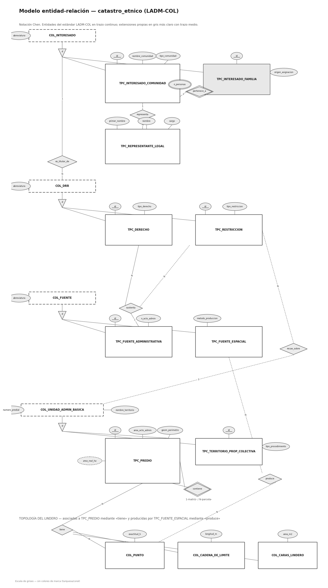

*Figura 15. Modelo general: clases LADM-COL y sus tablas reales.*

> **Privacidad.** Los datos reales de las comunidades **no** se publican en este repositorio. Las fotos y audios se guardan fuera del código, y los datos territoriales se manejan bajo acuerdos de gobernanza de datos con las comunidades.
